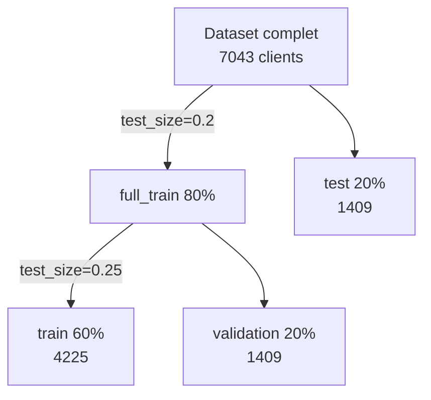
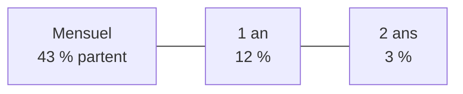
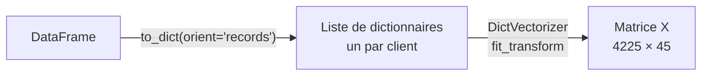
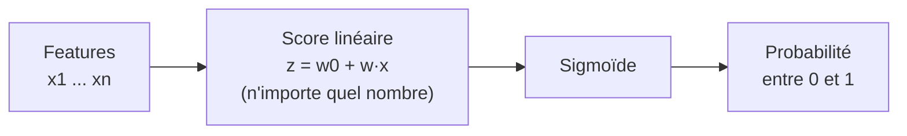
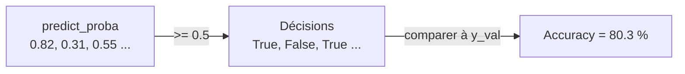
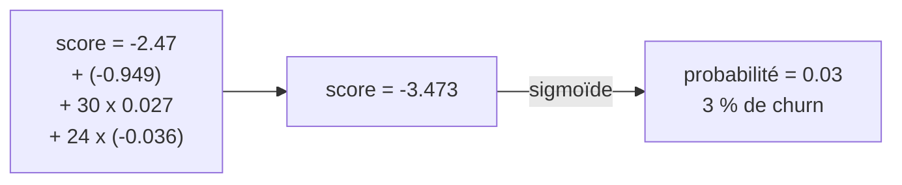
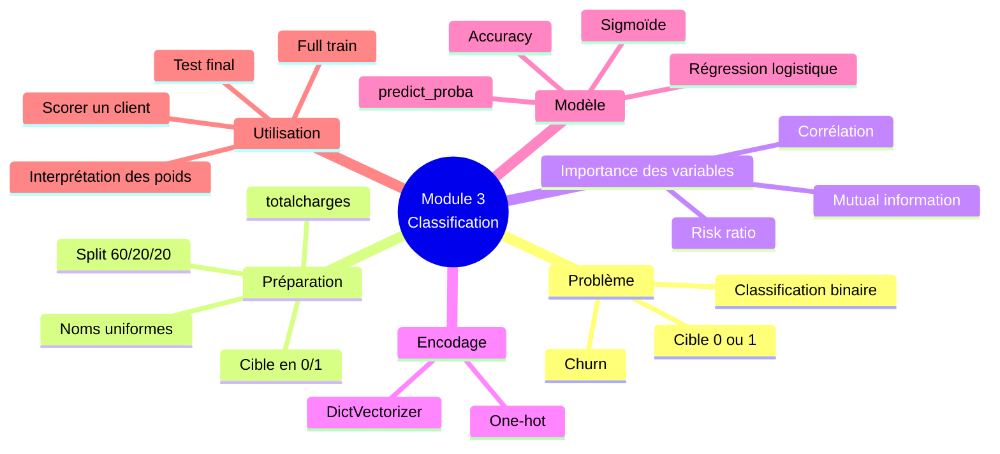

# Module 3 — Machine Learning for Classification

> Résumé personnel du Module 3 du [Machine Learning Zoomcamp](https://github.com/DataTalksClub/machine-learning-zoomcamp/blob/master/03-classification/README.md) (DataTalksClub).
> Fil rouge du module : **prédire quels clients d'un opérateur télécom vont partir** (*churn*), avec le dataset Kaggle Telco Customer Churn (7 043 clients).

---

## Sommaire

| # | Leçon | Idée clé |
|---|---|---|
| [3.1](#31--le-projet-churn) | Projet churn | Classification binaire : un score entre 0 et 1 par client |
| [3.2](#32--préparation-des-données) | Préparation des données | Noms uniformes, `totalcharges` à corriger, cible en 0/1 |
| [3.3](#33--cadre-de-validation) | Validation framework | `train_test_split` en deux étapes (60/20/20) |
| [3.4](#34--eda) | EDA | Pas de NA, taux de churn global = 27 % |
| [3.5](#35--importance-des-variables-churn-rate-et-risk-ratio) | Churn rate et risk ratio | Comparer chaque groupe à la moyenne globale |
| [3.6](#36--importance-des-variables-mutual-information) | Mutual information | Un score par variable catégorielle |
| [3.7](#37--importance-des-variables-corrélation) | Corrélation | Un score par variable numérique |
| [3.8](#38--one-hot-encoding) | One-hot encoding | `DictVectorizer` : catégories en colonnes 0/1 |
| [3.9](#39--régression-logistique) | Régression logistique | Régression linéaire + sigmoïde |
| [3.10](#310--entraîner-avec-scikit-learn) | Entraînement avec Scikit-Learn | `fit`, `predict_proba`, accuracy |
| [3.11](#311--interpréter-le-modèle) | Interprétation | Lire les poids, petit modèle, calcul à la main |
| [3.12](#312--utiliser-le-modèle) | Utiliser le modèle | Full train, test, scorer un client |
| [3.13](#313--résumé) | Résumé | Vue d'ensemble |
| [3.14](#314--pour-aller-plus-loin) | Explorer plus | Pistes d'extension, autres projets |

---

## Ce qui change par rapport au Module 2

| | Module 2 (régression) | Module 3 (classification) |
|---|---|---|
| Question | Combien ? | Oui ou non ? |
| Cible `y` | Un nombre (prix) | 0 ou 1 (parti / resté) |
| Sortie du modèle | N'importe quel nombre | Une **probabilité** entre 0 et 1 |
| Modèle | Régression linéaire | **Régression logistique** |
| Mesure d'erreur | RMSE | **Accuracy** (pour commencer) |

Le reste de la méthode ne change pas : on prépare, on découpe en train / validation / test, on encode, on entraîne, on évalue sur la validation.


---

## 3.1 · Le projet churn

**Churn** : un client arrête d'utiliser le service. Pour un opérateur télécom, perdre un client coûte cher, donc on veut **repérer ceux qui vont partir avant qu'ils partent**.

**Idée :** pour chaque client, calculer un score entre 0 et 1, la probabilité de départ. L'entreprise cible ensuite ceux dont le score est élevé (par exemple avec un email de réduction).


**Classification binaire :** pour le client `i`, on veut que le modèle approche la cible :

$$g(x_i) \approx y_i, \quad y_i \in \{0, 1\}$$

- `1` = classe positive : le client **est parti** (churn)
- `0` = classe négative : le client **est resté**

On apprend `g` sur l'historique (le mois précédent, où l'on sait déjà qui est parti), puis on l'applique aux clients actuels.

**Dataset :** Telco Customer Churn (Kaggle). Une ligne = un client. Colonnes :

| Groupe | Colonnes |
|---|---|
| Démographie | `gender`, `seniorcitizen`, `partner`, `dependents` |
| Services | `phoneservice`, `multiplelines`, `internetservice`, `onlinesecurity`, `onlinebackup`, `deviceprotection`, `techsupport`, `streamingtv`, `streamingmovies` |
| Compte | `contract`, `paperlessbilling`, `paymentmethod` |
| Montants | `monthlycharges`, `totalcharges` |
| Ancienneté | `tenure` (en mois) |
| **Cible** | `churn` |

---

## 3.2 · Préparation des données

Téléchargement avec `wget`, lecture avec pandas :

```python
df = pd.read_csv('data-week-3.csv')
df.head().T        # .T transpose : on voit toutes les colonnes d'un coup
```

**Étape 1 : uniformiser** (même traitement qu'au Module 2) :

```python
df.columns = df.columns.str.lower().str.replace(' ', '_')

categorical_columns = list(df.dtypes[df.dtypes == 'object'].index)
for c in categorical_columns:
    df[c] = df[c].str.lower().str.replace(' ', '_')
```

**Étape 2 : réparer `totalcharges`.** Pandas l'a lue comme du texte (`object`) alors que ce sont des nombres. La conversion directe échoue (`Unable to parse string "_"`), car les valeurs manquantes étaient des espaces, devenus `_` après notre nettoyage.


```python
df.totalcharges = pd.to_numeric(df.totalcharges, errors='coerce')
df.totalcharges = df.totalcharges.fillna(0)
```

Les 11 lignes concernées sont des **clients tout juste arrivés** : pas encore facturés, donc 0 est cohérent ici.

**Étape 3 : la cible en nombres.** `churn` contient `yes` / `no`, il faut du 0/1 :

```python
df.churn = (df.churn == 'yes').astype(int)
```

| Avant | Après |
|---|---|
| `yes` | `1` |
| `no` | `0` |

`seniorcitizen` est déjà en 0/1 : on la traitera comme une variable **catégorielle**.

---

## 3.3 · Cadre de validation

`train_test_split` ne coupe qu'en **deux**, donc on le fait en **deux étapes** :



```python
from sklearn.model_selection import train_test_split

df_full_train, df_test = train_test_split(df, test_size=0.2, random_state=1)
df_train, df_val = train_test_split(df_full_train, test_size=0.25, random_state=1)
```

**Pourquoi `0.25` et pas `0.2` ?** Le second découpage porte sur 80 % des données. Or 20 % de l'ensemble total = **25 % de ces 80 %** (0,8 × 0,25 = 0,2). Ainsi validation et test ont la même taille.

- `random_state=1` fixe le tirage au sort : le découpage est aléatoire mais **reproductible**.
- `reset_index(drop=True)` remet un index propre après le mélange.
- On sort la cible dans `y_train`, `y_val`, `y_test` (avec `.values`), puis on **supprime** `churn` des dataframes avec `del`, pour ne jamais l'utiliser comme feature par accident.
- On garde `churn` dans `df_full_train` : on en a besoin pour l'EDA.

---

## 3.4 · EDA

On explore **uniquement le full train** (jamais le test).

**Valeurs manquantes :** `df_full_train.isnull().sum()` donne 0 partout (on a déjà traité `totalcharges`).

**Taux de churn global :**

```python
df_full_train.churn.value_counts(normalize=True)
# 0    0.730    (restés)
# 1    0.270    (partis)
```

Environ **73 % restent, 27 % partent**. Ce pourcentage de 1 s'appelle le **churn rate**.

> **Astuce :** la **moyenne** d'une colonne binaire 0/1 = la proportion de 1. Donc `df_full_train.churn.mean()` donne directement le churn rate (0.27).

**Séparer les variables :**

```python
numerical = ['tenure', 'monthlycharges', 'totalcharges']
categorical = ['gender', 'seniorcitizen', 'partner', 'dependents', 'phoneservice',
               'multiplelines', 'internetservice', 'onlinesecurity', 'onlinebackup',
               'deviceprotection', 'techsupport', 'streamingtv', 'streamingmovies',
               'contract', 'paperlessbilling', 'paymentmethod']
```

- `customerid` est exclu : c'est un identifiant, inutile comme feature.
- `seniorcitizen` est catégorielle (0/1 = non/oui).
- `df_full_train[categorical].nunique()` : la plupart ont 2 ou 3 valeurs, `paymentmethod` en a 4.

---

## 3.5 · Importance des variables : churn rate et risk ratio

**Question :** quelles variables influencent le churn ? On compare le churn rate de **chaque groupe** au churn rate **global** (0.27).

**Deux façons de comparer :**

| Mesure | Formule | Lecture |
|---|---|---|
| **Différence** | `churn du groupe − churn global` | `> 0` : le groupe part plus que la moyenne |
| **Risk ratio** | `churn du groupe / churn global` | `= 1` comme tout le monde, `> 1` plus de risque, `< 1` moins |

**Exemple `gender` (presque aucun effet) :**

| gender | churn rate | risk |
|---|---:|---:|
| female | 0.277 | 1.03 |
| male | 0.263 | 0.97 |

→ Risk ratio proche de 1 : savoir si le client est un homme ou une femme n'apprend presque rien.

**Exemple `partner` (effet net) :**

| partner | churn rate | risk |
|---|---:|---:|
| no | 0.330 | 1.22 |
| yes | 0.205 | 0.76 |

→ Sans partenaire, on part **22 % plus souvent** que la moyenne. Avec partenaire, **24 % moins souvent**.

**Exemple `contract` (effet très fort) :**

| contract | churn rate | risk |
|---|---:|---:|
| month-to-month | 0.432 | 1.60 |
| one_year | 0.121 | 0.45 |
| two_year | 0.028 | 0.10 |



**Pour toutes les variables d'un coup, avec `groupby` :**

```python
for c in categorical:
    df_group = df_full_train.groupby(c).churn.agg(['mean', 'count'])
    df_group['diff'] = df_group['mean'] - global_churn
    df_group['risk'] = df_group['mean'] / global_churn
    display(df_group)
```

C'est l'équivalent pandas d'un `SELECT AVG(churn) ... GROUP BY ...` en SQL. Plus la différence est grande en valeur absolue (ou le risk ratio loin de 1), plus la variable est importante.

---

## 3.6 · Importance des variables : mutual information

Le risk ratio compare des **groupes à l'intérieur d'une variable**. Pour comparer des **variables entre elles**, il faut un seul nombre par variable : la **mutual information** (information mutuelle).

**Idée :** combien apprend-on sur le churn en connaissant la valeur de cette variable ?

- Score **élevé** : la variable informe beaucoup sur le churn → importante.
- Score **0** : la variable n'apprend rien.

```python
from sklearn.metrics import mutual_info_score
mutual_info_score(df_full_train.churn, df_full_train.contract)   # 0.098
```

L'ordre des deux arguments n'a pas d'importance (mesure symétrique).

**Sur toutes les variables catégorielles :**

```python
def mutual_info_churn_score(series):
    return mutual_info_score(series, df_full_train.churn)

mi = df_full_train[categorical].apply(mutual_info_churn_score)
mi.sort_values(ascending=False)
```

| Variable | MI |
|---|---:|
| **contract** | **0.098** |
| onlinesecurity | 0.063 |
| techsupport | 0.061 |
| internetservice | 0.056 |
| ... | ... |
| multiplelines | 0.0009 |
| phoneservice | 0.0002 |
| gender | 0.0001 |

`contract` domine, `gender` ne sert pratiquement à rien. Cela confirme ce que montraient les risk ratios.

> La mutual information sert pour les variables **catégorielles**. Pour les numériques, on utilise la corrélation.

---

## 3.7 · Importance des variables : corrélation

Le **coefficient de corrélation de Pearson** `r` mesure la dépendance entre deux variables. Il est toujours entre **−1 et 1**.


| `|r|` | Force |
|---|---|
| 0 à 0.2 | Faible |
| 0.2 à 0.5 | Moyenne |
| 0.5 à 1 | Forte |

Le **signe** donne la direction, la **valeur absolue** donne la force.

**Avec une cible binaire :** une corrélation positive signifie que les valeurs élevées de la variable vont avec **plus de churn**, une négative avec **moins de churn**.

```python
df_full_train[numerical].corrwith(df_full_train.churn)
```

| Variable | r | Lecture |
|---|---:|---|
| tenure | −0.35 | Plus on est client longtemps, moins on part (moyenne) |
| monthlycharges | +0.20 | Plus on paie cher par mois, plus on part |
| totalcharges | −0.20 | Normal : le total augmente avec l'ancienneté |

Pour classer l'importance, seule la force compte, d'où `.abs()` : `tenure` est la variable numérique la plus importante.

**Vérification par groupes** (churn rate selon l'ancienneté) :

| Ancienneté | Churn |
|---|---:|
| 2 mois ou moins | 59.5 % |
| 3 à 12 mois | 39.9 % |
| plus de 12 mois | 17.6 % |

Le churn baisse nettement avec l'ancienneté, exactement ce que disait la corrélation négative.

---

## 3.8 · One-hot encoding

Un modèle ne sait travailler qu'avec des **nombres** : on ne peut pas multiplier `two_year` par un poids. Le **one-hot encoding** remplace une colonne catégorielle par **une colonne binaire par catégorie**.

| gender | contract | gender=F | gender=M | contract=M | contract=1Y | contract=2Y |
|---|---|---:|---:|---:|---:|---:|
| F | 2Y | 1 | 0 | 0 | 0 | 1 |
| F | 1Y | 1 | 0 | 0 | 1 | 0 |
| M | M | 0 | 1 | 1 | 0 | 0 |
| M | 1Y | 0 | 1 | 0 | 1 | 0 |

Dans chaque groupe de colonnes, **un seul `1`** (d'où « *one-hot* »). Les variables numériques passent telles quelles.

**Avec Scikit-Learn : `DictVectorizer`.**



```python
from sklearn.feature_extraction import DictVectorizer

dv = DictVectorizer(sparse=False)

train_dict = df_train[categorical + numerical].to_dict(orient='records')
X_train = dv.fit_transform(train_dict)        # X_train.shape = (4225, 45)

val_dict = df_val[categorical + numerical].to_dict(orient='records')
X_val = dv.transform(val_dict)                # transform seulement !
```

- `fit` **apprend** la liste des catégories, `transform` **applique** l'encodage.
- On fait `fit` **uniquement sur le train**. Validation et test sont encodés avec **le même** vectorizer, sinon les colonnes ne correspondraient pas.
- `sparse=False` donne un tableau NumPy classique (par défaut, c'est une matrice creuse qui ne stocke que les valeurs non nulles).
- 45 colonnes = une par valeur de catégorie + les 3 numériques. `dv.get_feature_names_out()` les liste (`contract=month-to-month`, `internetservice=fiber_optic`, ...).

---

## 3.9 · Régression logistique

Même modèle linéaire qu'au Module 2, avec **une étape de plus** : la **sigmoïde**.

$$g(x_i) = \text{Sigmoid}(w_0 + w_1 x_1 + \dots + w_n x_n)$$

$$\text{Sigmoid}(z) = \frac{1}{1 + e^{-z}}$$



**Pourquoi la sigmoïde ?** Le score linéaire peut valoir −50 ou +300, mais une probabilité doit rester entre 0 et 1. La sigmoïde « écrase » tout nombre dans cet intervalle.

| Score `z` | Sigmoïde(z) |
|---:|---:|
| très négatif | proche de 0 |
| 0 | 0.5 (pile ou face) |
| très positif | proche de 1 |

La courbe a une forme de **S**.

**En code, c'est presque identique à la régression linéaire :**

```python
def sigmoid(z):
    return 1 / (1 + np.exp(-z))

def logistic_regression(xi):
    score = w0
    for j in range(len(w)):
        score = score + xi[j] * w[j]
    return sigmoid(score)            # seule différence avec la régression linéaire
```

> **À retenir :** régression logistique = régression linéaire + sigmoïde, ce qui rend la sortie interprétable comme une probabilité. Les deux sont des **modèles linéaires** (le score à l'intérieur reste une combinaison linéaire des features).

---

## 3.10 · Entraîner avec Scikit-Learn

Même schéma que pour `LinearRegression` : créer le modèle, puis `fit`.

```python
from sklearn.linear_model import LogisticRegression

model = LogisticRegression(solver='lbfgs')
model.fit(X_train, y_train)
```

Après l'entraînement :

- `model.intercept_[0]` : le biais `w0` (≈ −0.109)
- `model.coef_[0]` : les 45 poids, un par colonne

**Deux types de prédictions :**

| Méthode | Retourne | Usage |
|---|---|---|
| `model.predict(X)` | Réponse dure : 0 ou 1 | Décision finale seule |
| `model.predict_proba(X)` | Probabilités (2 colonnes, somme = 1) | On choisit **notre** seuil |

```python
y_pred = model.predict_proba(X_val)[:, 1]     # colonne 1 = probabilité de churn
churn_decision = (y_pred >= 0.5)              # seuil de 0.5
```

**Accuracy :** la part de prédictions justes.

```python
(y_val == churn_decision).mean()              # 0.803
```



La moyenne d'une colonne booléenne compte la proportion de `True` (True = 1, False = 0). Le choix du seuil 0.5 influence l'accuracy : on verra plus tard comment mieux le choisir avec d'autres métriques.

---

## 3.11 · Interpréter le modèle

**Associer chaque poids à son nom** avec `zip` :

```python
dict(zip(dv.get_feature_names_out(), model.coef_[0].round(3)))
```

| Feature | Poids | Effet |
|---|---:|---|
| contract=month-to-month | +0.475 | Fait monter le risque |
| contract=two_year | −0.408 | Fait baisser le risque (le plus négatif) |
| internetservice=fiber_optic | +0.316 | Fait monter le risque |

**Règle :** poids positif = pousse la probabilité de churn **vers le haut**, poids négatif = **vers le bas**. C'est cohérent avec l'analyse d'importance du début du module.

**Pourquoi un seul poids sert par client :** avec le one-hot, un client mensuel a `contract=month-to-month = 1` et les deux autres colonnes de contrat à 0. Seul le poids de **sa** catégorie compte dans la somme.

**Petit modèle pour y voir clair.** Avec 45 poids corrélés, c'est dur à lire. On entraîne un modèle sur **3 features** (`contract`, `tenure`, `monthlycharges`) :

| Feature | Poids |
|---|---:|
| contract=month-to-month | +0.97 |
| contract=one_year | −0.025 |
| contract=two_year | −0.949 |
| monthlycharges | +0.027 |
| tenure | −0.036 |
| biais `w0` | −2.477 |

Lecture : être en mensuel augmente beaucoup le risque, chaque mois d'ancienneté le diminue un peu, chaque dollar de facture mensuelle l'augmente un peu.

**Calcul à la main** : client en contrat 2 ans, 30 $/mois, 24 mois d'ancienneté.



Un client fidèle sous contrat de 2 ans : 3 % de risque, exactement ce qu'on attend. Un client mensuel à 50 $/mois avec 5 mois d'ancienneté : score −0.33, probabilité ≈ **0.42**.

---

## 3.12 · Utiliser le modèle

**Modèle final :** on n'a plus besoin de la validation pour régler quoi que ce soit, donc on **réentraîne sur train + validation** (`df_full_train`), avec un **nouveau** `DictVectorizer` (encodage et modèle vont toujours ensemble).

```python
dicts_full_train = df_full_train[categorical + numerical].to_dict(orient='records')
dv = DictVectorizer(sparse=False)
X_full_train = dv.fit_transform(dicts_full_train)
y_full_train = df_full_train.churn.values

model = LogisticRegression(solver='lbfgs')
model.fit(X_full_train, y_full_train)
```

**Vérification sur le test** (gardé intact jusque-là) :

```python
dicts_test = df_test[categorical + numerical].to_dict(orient='records')
X_test = dv.transform(dicts_test)
y_pred = model.predict_proba(X_test)[:, 1]
((y_pred >= 0.5) == y_test).mean()          # 0.815
```

Accuracy test **81.5 %** contre 80.3 % en validation : les deux sont proches, c'est bon signe. Un grand écart indiquerait du **surapprentissage** (*overfitting*).

**Scorer un seul client :**

```python
customer = dicts_test[-1]                       # un dictionnaire
X_small = dv.transform([customer])              # entre crochets : liste d'un élément
model.predict_proba(X_small)[0, 1]              # 0.597
```

Le modèle donne **60 %** de risque, au-dessus du seuil 0.5, et ce client est effectivement parti (`y_test[-1] == 1`).


Le modèle n'est que des **nombres** (poids + biais) et le vectorizer (la liste des catégories). Pour l'utiliser hors du notebook, il faudra sauvegarder les deux dans un fichier (module suivant sur le déploiement).

---

## 3.13 · Résumé



**À retenir :**

| Sujet | À retenir |
|---|---|
| Cible | Binaire, encodée 0/1, la moyenne = taux de 1 |
| Importance (catégorielles) | Risk ratio (par groupe), **mutual information** (par variable) |
| Importance (numériques) | **Corrélation** (`corrwith`), valeur absolue pour la force |
| Encodage | One-hot avec `DictVectorizer`, `fit` sur le train, `transform` ailleurs |
| Modèle | Logistique = linéaire + sigmoïde, sortie = probabilité |
| Prédiction | `predict_proba(X)[:, 1]` puis seuil (0.5 par défaut) |
| Métrique | Accuracy = part de prédictions justes |
| Poids | Positif = plus de churn, négatif = moins de churn |
| Modèle final | Train + validation, un seul passage sur le test |

**Chiffres clés du projet :**

| Élément | Valeur |
|---|---:|
| Clients | 7 043 |
| Churn global | 27 % |
| Variable catégorielle la plus informative | `contract` (MI = 0.098) |
| Variable numérique la plus corrélée | `tenure` (r = −0.35) |
| Colonnes après one-hot | 45 |
| Accuracy validation | 80.3 % |
| Accuracy test | 81.5 % |

---

## 3.14 · Pour aller plus loin

Pistes proposées par le cours :

- Essayer d'**exclure les variables les moins utiles** et voir l'effet sur l'accuracy.
- Reprendre le projet du module précédent avec Scikit-Learn : `train_test_split`, `LinearRegression` (non régularisée) et `Ridge` (régularisée, en cherchant le meilleur paramètre).
- Essayer d'autres encodages, comme `OneHotEncoder`.
- Essayer le **scaling** des variables numériques avec `StandardScaler`, utile pour les solveurs itératifs comme `lbfgs`.
- Autres projets de classification : [Lead scoring](https://www.kaggle.com/ashydv/leads-dataset) et [Default prediction](https://archive.ics.uci.edu/ml/datasets/default+of+credit+card+clients).

---

## Ressources

- [README source du Module 3](https://github.com/DataTalksClub/machine-learning-zoomcamp/blob/master/03-classification/README.md)
- [Playlist YouTube du cours](https://www.youtube.com/playlist?list=PL3MmuxUbc_hIhxl5Ji8t4O6lPAOpHaCLR)
- [FAQ officielle](https://datatalks.club/faq/machine-learning-zoomcamp.html)