# Module 4 — Evaluation Metrics for Classification

> Résumé personnel du Module 4 du [Machine Learning Zoomcamp](https://github.com/DataTalksClub/machine-learning-zoomcamp/blob/master/04-evaluation/README.md) (DataTalksClub).
> Fil rouge du module : on reprend le **modèle de churn du Module 3** (régression logistique) et on répond à une question : **comment savoir s'il est bon ?**

---

## Sommaire

| # | Leçon | Idée clé |
|---|---|---|
| [4.1](#41--vue-densemble) | Vue d'ensemble | Une métrique = un nombre qui résume la qualité des prédictions |
| [4.2](#42--accuracy-et-modèle-dummy) | Accuracy et modèle dummy | 80 % semble bon, mais un modèle qui ne fait rien obtient 73 % |
| [4.3](#43--matrice-de-confusion) | Matrice de confusion | 4 cas : TP, TN, FP, FN |
| [4.4](#44--precision-et-recall) | Precision et recall | Deux regards sur la classe positive |
| [4.5](#45--courbes-roc) | Courbes ROC | TPR contre FPR sur tous les seuils |
| [4.6](#46--roc-auc) | ROC AUC | L'aire sous la courbe, un seul nombre |
| [4.7](#47--validation-croisée) | Validation croisée | Moyenne + écart-type sur K découpages, pour régler `C` |
| [4.8](#48--résumé) | Résumé | Toutes les métriques en un coup d'œil |
| [4.9](#49--pour-aller-plus-loin) | Explorer plus | F1, courbe précision-recall |

---

## Le problème du module

Le modèle de churn du Module 3 prédit une **probabilité** de départ pour chaque client. Pour décider, on choisit un **seuil** (par exemple 0.5) : au-dessus, on prédit « va partir », en dessous « va rester ».

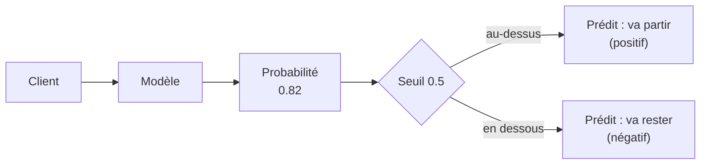

Tout le module revient à étudier **les erreurs que ce modèle commet** et **comment les mesurer**.

---

## 4.1 · Vue d'ensemble

**Métrique :** une fonction qui prend les **prédictions** et les **vraies valeurs**, et renvoie **un seul nombre** décrivant la qualité du modèle. Chaque métrique regarde un aspect différent des erreurs.

**Le point de départ (rappel du Module 3) :**

- 7 043 clients, découpage 60 / 20 / 20 avec `random_state=1`
- Modèle de régression logistique, seuil 0.5
- Accuracy sur la validation : **0.803** (1 132 bonnes décisions sur 1 409)

```python
y_pred = model.predict_proba(X_val)[:, 1]
churn_decision = (y_pred >= 0.5)
(y_val == churn_decision).mean()          # 0.803
```

**Ce que couvre le module :**

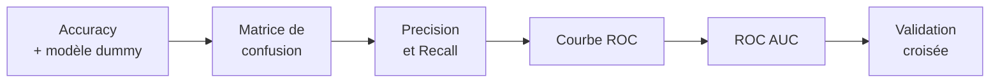

---

## 4.2 · Accuracy et modèle dummy

**Accuracy** = nombre de prédictions correctes / nombre total de prédictions.

```python
from sklearn.metrics import accuracy_score
accuracy_score(y_val, y_pred >= 0.5)      # 0.803
```

**Le seuil 0.5 est-il le meilleur ?** On teste tous les seuils de 0 à 1 :

| Seuil | Accuracy |
|---:|---:|
| 0.00 | 0.274 |
| 0.25 | 0.739 |
| 0.40 | 0.785 |
| **0.50** | **0.803** |
| 0.55 | 0.801 |
| 0.70 | 0.766 |
| 1.00 | 0.726 |

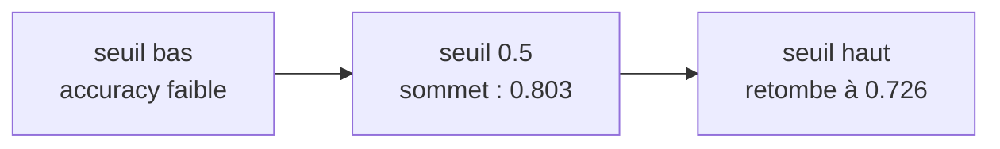

Ici 0.5 est bien le meilleur seuil. Ce n'est pas toujours le cas : cette petite boucle sert à le vérifier.

**Le modèle dummy (la vérification qui dérange).** Que se passe-t-il si on ne fait **aucun modèle** et qu'on prédit « personne ne partira » ? C'est un seuil de 1.0 : aucune probabilité ne l'atteint, donc tout le monde est prédit « reste ».

```python
1 - y_val.mean()          # 0.726
```

| Modèle | Accuracy |
|---|---:|
| Dummy (« personne ne part ») | **0.726** |
| Notre régression logistique | **0.803** |

L'amélioration réelle n'est que de **7 points**, bien moins que « 80 % de réussite » ne le laissait croire.

**Pourquoi ? Le déséquilibre des classes (*class imbalance*).** Seuls 27 % des clients partent, 73 % restent. Un modèle peut avoir une bonne accuracy en prédisant toujours la classe majoritaire, tout en étant **inutile pour la classe qui nous intéresse** : les clients sur le point de partir.

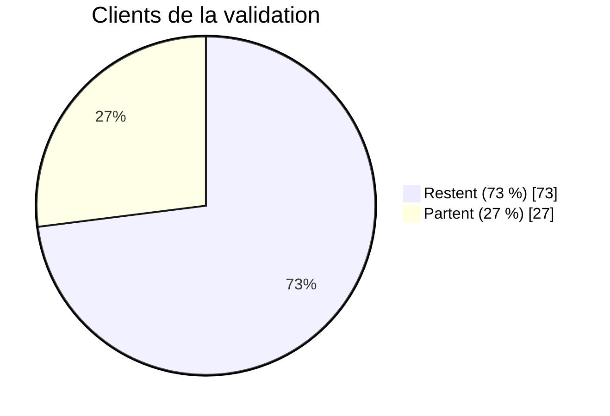

> **À retenir :** avec des classes déséquilibrées, l'accuracy seule ne permet pas de juger un modèle. Il faut regarder les erreurs en détail.

---

## 4.3 · Matrice de confusion

Pour chaque client, il y a **quatre issues possibles**, selon ce qu'on a prédit et ce qui s'est réellement passé :

| Prédiction | Réalité | Nom |
|---|---|---|
| Va partir (positif) | Est parti | **TP** : vrai positif |
| Va partir (positif) | Est resté | **FP** : faux positif |
| Va rester (négatif) | Est parti | **FN** : faux négatif |
| Va rester (négatif) | Est resté | **TN** : vrai négatif |

**Comment lire les noms :** « positif / négatif » = ce qu'on a **prédit**, « vrai / faux » = si la prédiction était **correcte**.

- **Faux positif :** on envoie un email de réduction à un client qui n'allait pas partir. Coût : une promotion gaspillée.
- **Faux négatif :** un client part sans qu'on l'ait repéré. C'est souvent l'erreur **la plus coûteuse**.

**Calcul avec NumPy** (seuil 0.5) :

```python
actual_positive = (y_val == 1)
actual_negative = (y_val == 0)

predict_positive = (y_pred >= 0.5)
predict_negative = (y_pred < 0.5)

tp = (predict_positive & actual_positive).sum()
tn = (predict_negative & actual_negative).sum()
fp = (predict_positive & actual_negative).sum()
fn = (predict_negative & actual_positive).sum()
```

**Résultat sur la validation :**

|  | Prédit négatif | Prédit positif |
|---|---:|---:|
| **Réel négatif** | TN = **922** | FP = **101** |
| **Réel positif** | FN = **176** | TP = **210** |

Vérification : 922 + 101 + 176 + 210 = **1 409** (tous les clients).

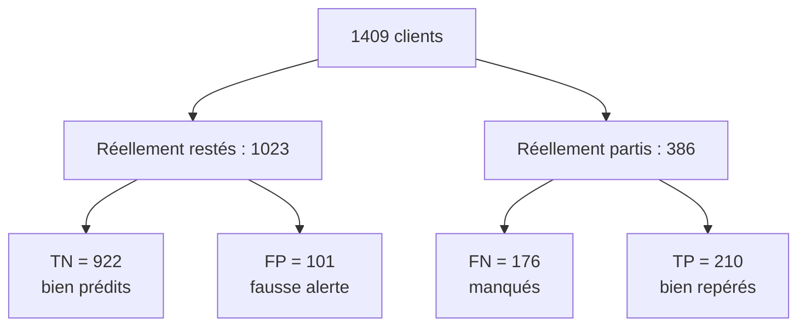

En fractions du total : 65 % TN, 7 % FP, 12 % FN, 15 % TP.

**Lien avec l'accuracy :** c'est la **diagonale** (TN + TP) divisée par le total : (922 + 210) / 1409 = 0.803. La matrice ajoute ce que l'accuracy cachait : les 20 % d'erreurs se partagent en **7 % de faux positifs** et **12 % de faux négatifs**, deux erreurs aux coûts très différents.

---

## 4.4 · Precision et Recall

Les deux métriques regardent la **classe positive** (les clients qui partent), chacune sous un angle différent.

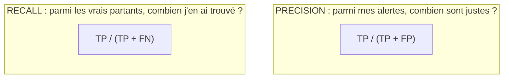

### Precision

$$P = \frac{TP}{TP + FP}$$

Elle regarde la **colonne « prédit positif »** de la matrice : 210 + 101 = **311 clients** reçoivent un email. Seuls 210 allaient vraiment partir.

```python
p = tp / (tp + fp)        # 210 / 311 = 0.675
```

→ **67 %** : un tiers des emails de réduction part chez des clients qui n'étaient pas à risque.

### Recall

$$R = \frac{TP}{TP + FN}$$

Il regarde la **ligne « réel positif »** : 210 + 176 = **386 clients** sont réellement partis, mais le modèle n'en a repéré que 210.

```python
r = tp / (tp + fn)        # 210 / 386 = 0.544
```

→ **54 %** : on rate presque la moitié des clients qui partent (176 sans aucune action de notre part).

| Métrique | Question posée | Valeur |
|---|---|---:|
| Accuracy | Quelle part de toutes mes décisions est juste ? | 0.803 |
| **Precision** | Quelle part de mes alertes est juste ? | **0.675** |
| **Recall** | Quelle part des vrais partants ai-je trouvée ? | **0.544** |

**Pourquoi ces deux-là sont meilleures que l'accuracy ici :** les partants ne sont que 27 % des données, donc les 12 % de faux négatifs bougent à peine l'accuracy, alors qu'ils représentent **la moitié des clients qu'on voulait sauver**. Quand les classes sont déséquilibrées (churn, fraude, diagnostic médical), on regarde precision et recall.

**Le compromis :** quand le seuil monte, on alerte moins de clients, donc la precision tend à monter et le recall à baisser, et inversement. Les deux sont en conflit.

---

## 4.5 · Courbes ROC

Precision et recall décrivent le modèle à **un seul seuil**. La courbe **ROC** (*Receiver Operating Characteristic*, idée née pendant la Seconde Guerre mondiale pour évaluer des détecteurs radio) le décrit à **tous les seuils à la fois**.

### TPR et FPR

| Taux | Formule | Lecture | On veut |
|---|---|---|---|
| **TPR** (true positive rate) | `TP / (TP + FN)` | Part des vrais partants repérés (c'est le **recall**) | le **maximiser** |
| **FPR** (false positive rate) | `FP / (FP + TN)` | Part des clients restés qu'on dérange à tort | le **minimiser** |

À seuil 0.5 : TPR = **0.544**, FPR = 101 / 1023 = **0.099** (on dérange 10 % des clients qui ne partaient pas).

### Calculer sur tous les seuils

```python
thresholds = np.linspace(0, 1, 101)
scores = []

for t in thresholds:
    predict_positive = (y_pred >= t)
    predict_negative = (y_pred < t)

    tp = (predict_positive & (y_val == 1)).sum()
    tn = (predict_negative & (y_val == 0)).sum()
    fp = (predict_positive & (y_val == 0)).sum()
    fn = (predict_negative & (y_val == 1)).sum()

    scores.append((t, tp, fp, fn, tn))

df_scores = pd.DataFrame(scores, columns=['threshold', 'tp', 'fp', 'fn', 'tn'])
df_scores['tpr'] = df_scores.tp / (df_scores.tp + df_scores.fn)
df_scores['fpr'] = df_scores.fp / (df_scores.fp + df_scores.tn)
```

Quand le seuil monte, on alerte moins de monde : **TPR et FPR baissent ensemble**.

### Deux repères pour lire la courbe

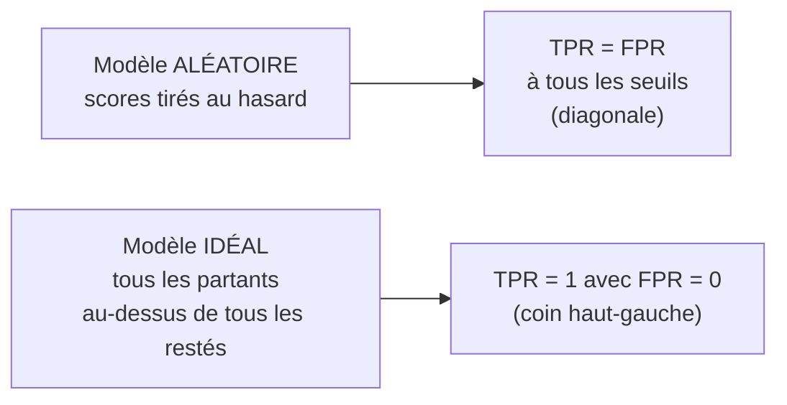

- **Aléatoire :** il ne sait pas distinguer les deux groupes, la part de partants repérés égale la part de restés dérangés. Son accuracy à 0.5 est d'environ 0.50 (pile ou face).
- **Idéal :** on le construit à la main (1 023 négatifs puis 386 positifs, scores étalés de 0 à 1). Avec le seuil à 0.726 (la proportion de négatifs), il atteint une accuracy de 1.0.

### La courbe ROC

On trace **TPR (axe vertical) contre FPR (axe horizontal)**. Chaque point = le modèle à un seuil.

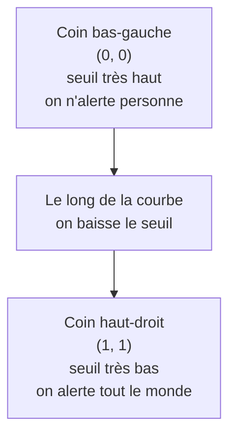

```python
plt.plot(df_scores.fpr, df_scores.tpr, label='Model')
plt.plot([0, 1], [0, 1], label='Random', linestyle='--')
plt.xlabel('FPR')
plt.ylabel('TPR')
plt.legend()
```

**Règle de lecture :** plus la courbe **colle au coin haut-gauche** (TPR élevé avec FPR faible), meilleur est le modèle. Une courbe sur la diagonale = modèle aléatoire.

**Avec Scikit-Learn** (même résultat, sans boucle) :

```python
from sklearn.metrics import roc_curve
fpr, tpr, thresholds = roc_curve(y_val, y_pred)
```

---

## 4.6 · ROC AUC

Une courbe est une image, pas un nombre. L'**AUC** (*Area Under the Curve*) est l'**aire sous la courbe ROC** : un seul nombre pour résumer la courbe.

| Modèle | AUC |
|---|---:|
| Aléatoire (la diagonale) | **0.5** |
| Idéal (tout le carré) | **1.0** |
| **Notre modèle de churn** | **0.844** |

**Repères pratiques :**

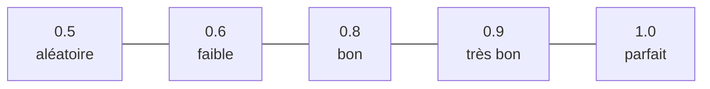

```python
from sklearn.metrics import auc, roc_auc_score

auc(fpr, tpr)                      # 0.8439
roc_auc_score(y_val, y_pred)       # 0.8439 (raccourci : courbe + aire d'un coup)
```

### Interprétation probabiliste

> L'AUC est la **probabilité qu'un client qui est parti, tiré au hasard, ait un score plus élevé qu'un client resté, tiré au hasard.**

Autrement dit, l'AUC mesure **à quel point le modèle classe bien** les clients (les partants au-dessus des restés).

**Vérification par simulation :** on tire 100 000 paires (un partant, un resté) et on compte combien de fois le partant a le plus grand score.

```python
neg = y_pred[y_val == 0]
pos = y_pred[y_val == 1]

n = 100000
success = 0
for i in range(n):
    pos_ind = random.randint(0, len(pos) - 1)
    neg_ind = random.randint(0, len(neg) - 1)
    if pos[pos_ind] > neg[neg_ind]:
        success = success + 1

success / n        # 0.8434  (proche de l'AUC de 0.8439)
```

**Pourquoi l'AUC est très utilisée :** elle mesure la capacité du modèle à **séparer les deux classes**, indépendamment du seuil choisi et du déséquilibre des classes.

---

## 4.7 · Validation croisée

Jusqu'ici on a mesuré le modèle **une seule fois**, sur une seule validation. La **validation croisée** (*cross-validation*) évalue le même modèle sur **plusieurs découpages** : on obtient une **moyenne** et un **écart-type**, et on peut s'en servir pour **régler les paramètres**.

### Principe du K-fold

On coupe le jeu d'entraînement complet (`df_full_train`) en **K parties** (*folds*). On entraîne sur K−1 parties, on valide sur la dernière, et on **recommence K fois** pour que chaque partie serve une fois de validation.

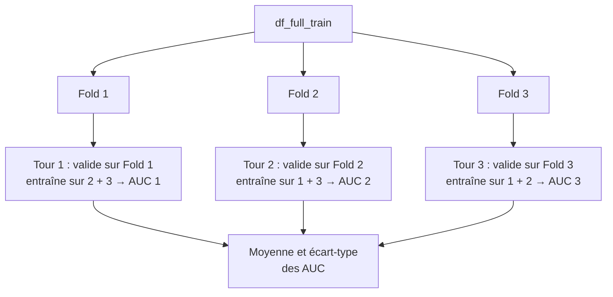

(Schéma à 3 folds pour la lisibilité ; en pratique on utilise 5.)

Le **test** reste **intact** jusqu'à la toute fin.

### Deux fonctions pour garder la boucle propre

```python
def train(df_train, y_train, C=1.0):
    dicts = df_train[categorical + numerical].to_dict(orient='records')
    dv = DictVectorizer(sparse=False)
    X_train = dv.fit_transform(dicts)

    model = LogisticRegression(C=C, max_iter=1000)
    model.fit(X_train, y_train)
    return dv, model

def predict(df, dv, model):
    dicts = df[categorical + numerical].to_dict(orient='records')
    X = dv.transform(dicts)
    return model.predict_proba(X)[:, 1]
```

### Boucle de validation croisée avec `KFold`

```python
from sklearn.model_selection import KFold

kfold = KFold(n_splits=5, shuffle=True, random_state=1)
scores = []

for train_idx, val_idx in kfold.split(df_full_train):
    df_train = df_full_train.iloc[train_idx]
    df_val = df_full_train.iloc[val_idx]

    y_train = df_train.churn.values
    y_val = df_val.churn.values

    dv, model = train(df_train, y_train, C=C)
    y_pred = predict(df_val, dv, model)

    scores.append(roc_auc_score(y_val, y_pred))
```

- `shuffle=True` : on mélange les lignes avant de couper.
- `random_state=1` : le mélange est reproductible.
- `kfold.split(...)` fournit à chaque tour deux listes d'**indices** (entraînement, validation), qu'on utilise avec `iloc`.

### Régler `C` (le paramètre de régularisation)

On répète la boucle pour plusieurs valeurs de `C` :

| C | AUC moyenne | Écart-type |
|---:|---:|---:|
| 0.001 | 0.825 | 0.009 |
| 0.01 | 0.840 | 0.009 |
| 0.1 | 0.841 | 0.008 |
| 0.5 | 0.840 | 0.007 |
| 1 | 0.841 | 0.008 |
| 5 | 0.841 | 0.008 |
| 10 | 0.841 | 0.008 |

**Lecture :**

- **La moyenne** dit la performance moyenne.
- **L'écart-type** dit la **stabilité** : plus il est petit, moins le score varie selon le découpage.
- À partir de `C = 0.01`, tout se vaut (0.840 à 0.841) ; seul `C = 0.001` est clairement moins bon. Le modèle n'est donc **pas très sensible à `C`** et la valeur par défaut `C = 1.0` convient.

**Rappel sur `C` :** c'est l'**inverse** de la force de régularisation. `C` petit = régularisation forte, `C` grand = régularisation faible.

### Modèle final

Une fois `C` choisi, on entraîne sur **tout** `df_full_train` et on évalue **une seule fois** sur le test :

```python
dv, model = train(df_full_train, df_full_train.churn.values, C=1.0)
y_pred = predict(df_test, dv, model)
roc_auc_score(y_test, y_pred)        # 0.857
```

L'AUC du test (0.857) est proche de celle de la validation croisée (0.841) : une petite différence est normale.

### Quand l'utiliser ?

| Situation | Choix |
|---|---|
| **Grand** jeu de données | Un seul découpage train / validation suffit (plus rapide, estimation déjà stable) |
| **Petit** jeu de données, ou besoin de mesurer la **stabilité** | Validation croisée |
| Plus de folds | Estimation plus fiable mais calcul plus long |

---

## 4.8 · Résumé

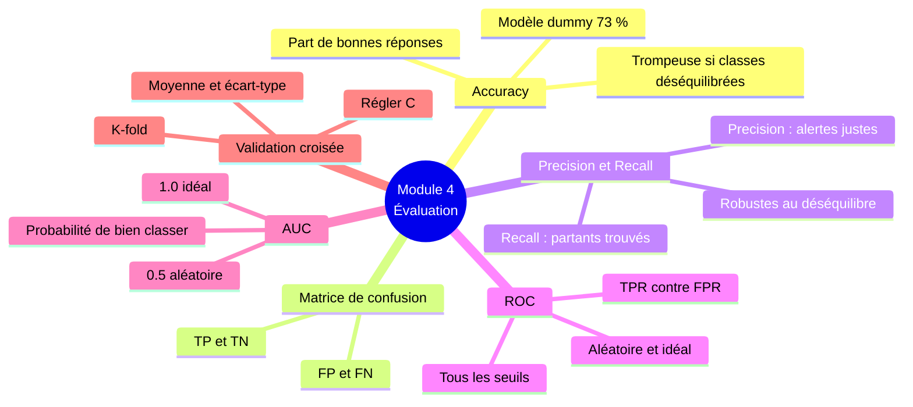

**Toutes les métriques en un tableau :**

| Métrique | Définition | À retenir |
|---|---|---|
| **Accuracy** | Part de réponses justes | Peut tromper quand les classes sont déséquilibrées |
| **Precision** | `TP / (TP + FP)` | Parmi mes alertes, combien sont justes |
| **Recall** (= TPR) | `TP / (TP + FN)` | Parmi les vrais positifs, combien j'en trouve |
| **FPR** | `FP / (FP + TN)` | Part des négatifs dérangés à tort |
| **Courbe ROC** | TPR contre FPR, tous les seuils | Utilisable même avec des classes déséquilibrées |
| **ROC AUC** | Aire sous la courbe ROC | 0.5 aléatoire, 1.0 parfait ; probabilité de classer un positif au-dessus d'un négatif |
| **K-fold CV** | Moyenne et écart-type sur K découpages | Estimation plus fiable, sert à régler les paramètres |

**Chiffres clés du projet churn :**

| Élément | Valeur |
|---|---:|
| Accuracy (seuil 0.5) | 0.803 |
| Accuracy du modèle dummy | 0.726 |
| TN / FP / FN / TP | 922 / 101 / 176 / 210 |
| Precision | 0.675 |
| Recall | 0.544 |
| ROC AUC (validation) | 0.844 |
| ROC AUC (validation croisée, C = 1) | 0.841 ± 0.008 |
| ROC AUC (test) | 0.857 |

La suite logique (Module 5) : prendre ce modèle de churn et le **déployer comme un service**.

---

## 4.9 · Pour aller plus loin

Pistes proposées par le cours :

- Calculer la **precision et le recall du classifieur dummy** qui prédit toujours « faux ».
- **Score F1**, qui combine precision et recall en un seul nombre :

$$F_1 = 2 \cdot \frac{P \cdot R}{P + R}$$

Avec nos valeurs (P = 0.675, R = 0.544), on obtient F1 ≈ **0.60**. Le F1 est élevé seulement si **les deux** sont élevés.

- Évaluer precision et recall à **différents seuils** et tracer P contre R : c'est la **courbe précision-recall**, comparable à la courbe ROC.
- L'**aire sous la courbe précision-recall** est aussi une métrique utile.
- Calculer ces métriques sur les jeux de données du module précédent.

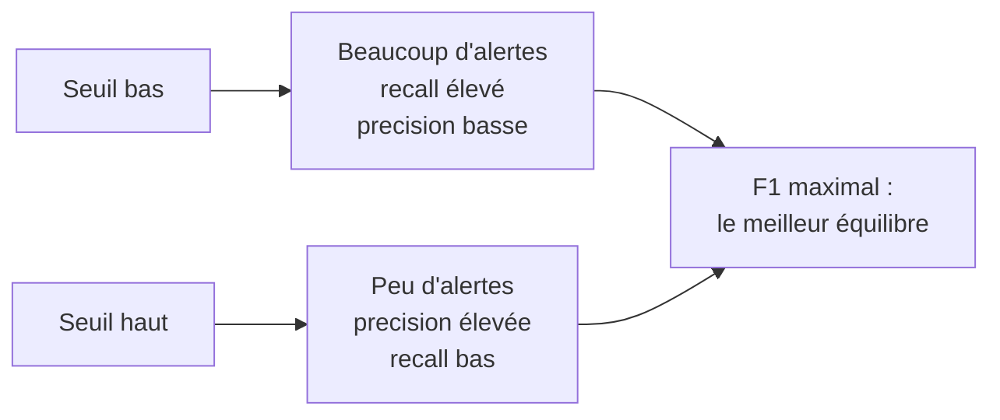

---

## Ressources

- [README source du Module 4](https://github.com/DataTalksClub/machine-learning-zoomcamp/blob/master/04-evaluation/README.md)
- [Slides du module](https://www.slideshare.net/AlexeyGrigorev/ml-zoomcamp-4-evaluation-metrics-for-classification)
- [Playlist YouTube du cours](https://www.youtube.com/playlist?list=PL3MmuxUbc_hIhxl5Ji8t4O6lPAOpHaCLR)
- [FAQ officielle](https://datatalks.club/faq/machine-learning-zoomcamp.html)