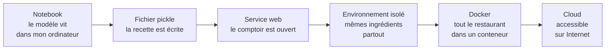
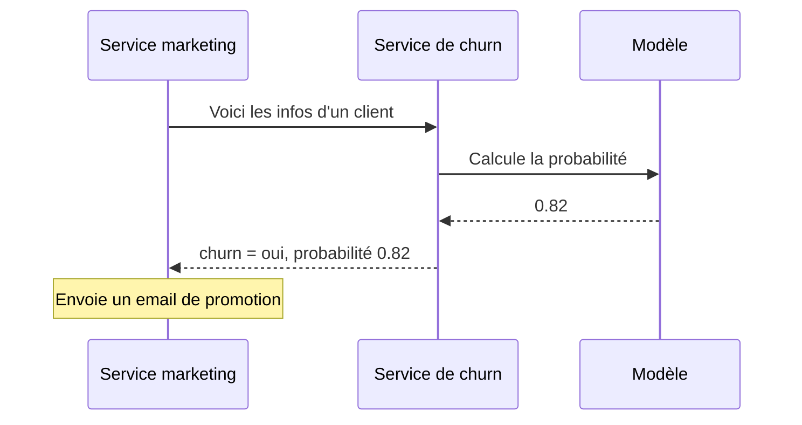
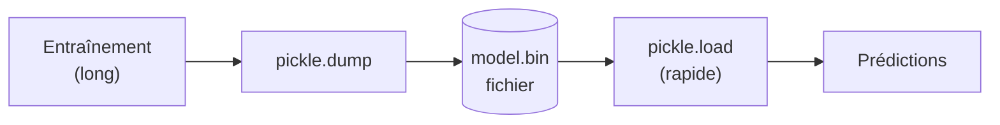
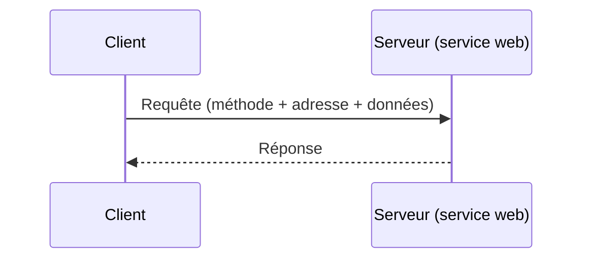
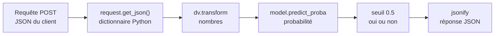
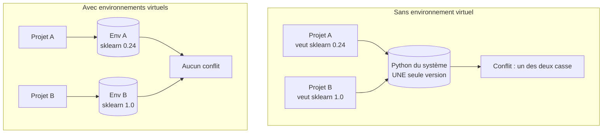
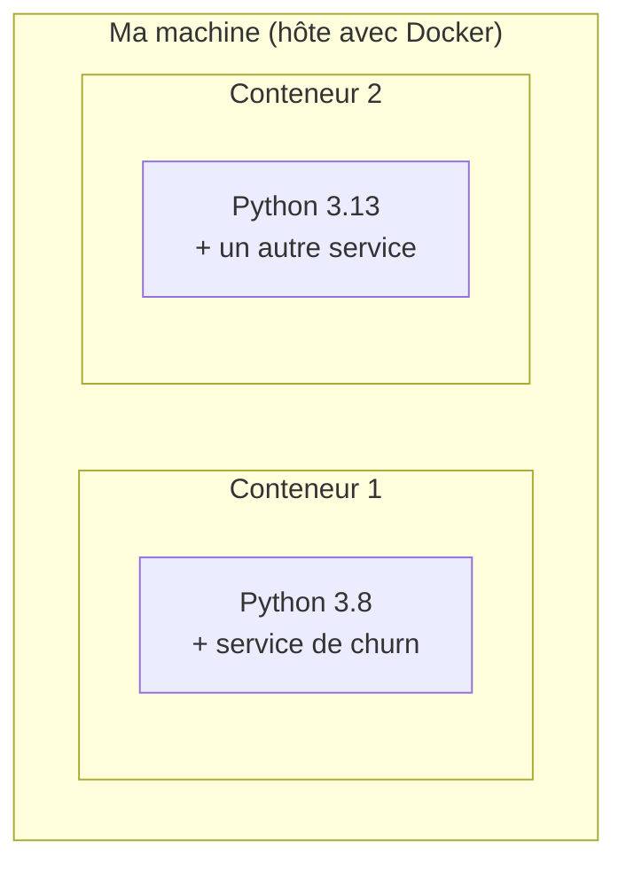
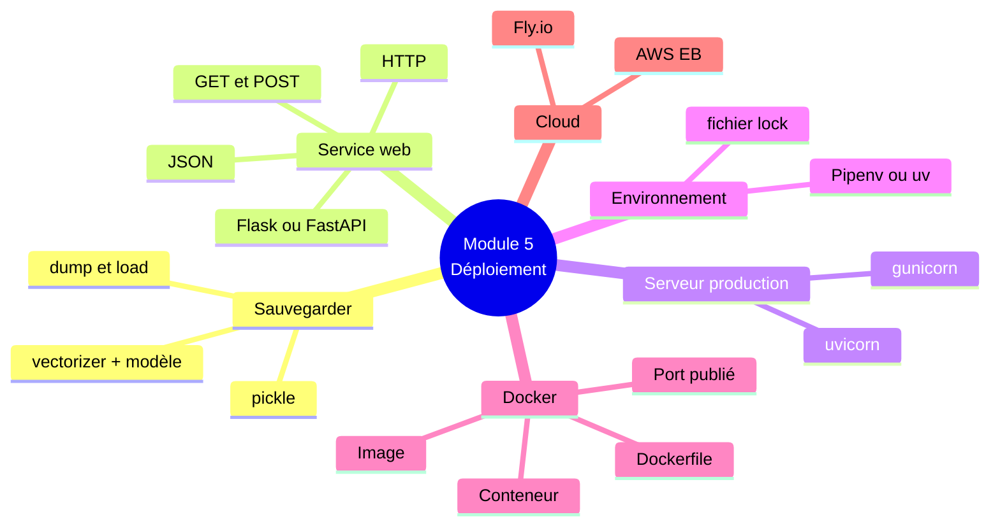
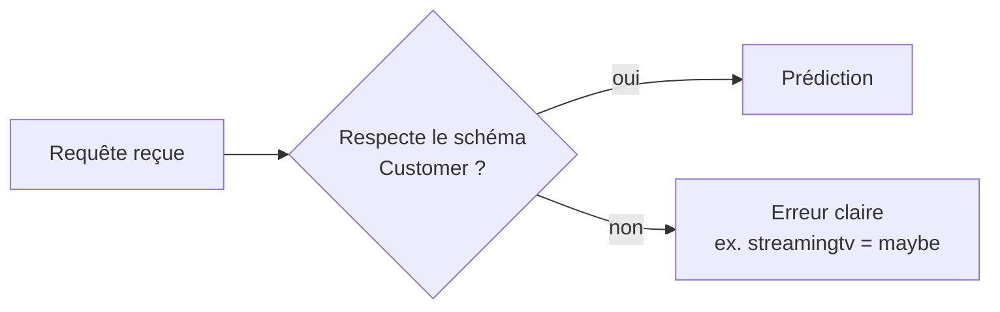
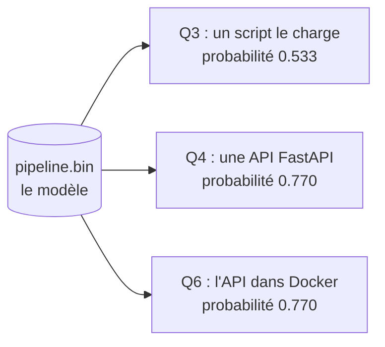

# Module 5 — Deploying Machine Learning Models

> Résumé personnel du Module 5 du [Machine Learning Zoomcamp](https://github.com/DataTalksClub/machine-learning-zoomcamp/blob/main/05-deployment/README.md) (DataTalksClub), écrit pour être **compris par un novice**.
> Fil rouge : on prend le **modèle de churn** et on le transforme en un **service que d'autres programmes peuvent appeler**.
> Le cours indique que la théorie des leçons 5.1 à 5.6 reste valable, mais que la partie pratique est mise à jour dans le **workshop** (uv, FastAPI, Fly.io à la place de Pipenv, Flask, AWS).

---

## Sommaire

| # | Leçon | Idée clé |
|---|---|---|
| [5.1](#51--pourquoi-déployer) | Pourquoi déployer | Un modèle dans un notebook ne sert à personne d'autre |
| [5.2](#52--sauvegarder-et-recharger-le-modèle-pickle) | Pickle | Entraîner une fois, sauvegarder dans un fichier, recharger |
| [5.3](#53--un-service-web-et-flask) | Service web et Flask | Requête, réponse, GET et POST |
| [5.4](#54--servir-le-modèle-de-churn) | Servir le modèle | Une route `/predict` qui reçoit du JSON et renvoie une probabilité |
| [5.5](#55--environnements-virtuels-pipenv) | Pipenv | Chaque projet a ses propres versions de bibliothèques |
| [5.6](#56--docker) | Docker | Emballer tout l'environnement dans une image |
| [5.7](#57--le-cloud-aws-elastic-beanstalk-optionnel) | Cloud (AWS EB) | Rendre le service accessible sur Internet |
| [5.8](#58--résumé) | Résumé | Une liste de 5 étapes |
| [5.9](#59--pour-aller-plus-loin) | Explorer plus | Autres outils |
| [Workshop](#workshop--la-version-moderne-fastapi-et-uv) | Version moderne | FastAPI, Pydantic, uv, Fly.io |
| [Homework](#ce-que-jai-fait-dans-le-homework-5) | Mon homework 5 | Même modèle appelé de 3 façons |

---

## L'idée en une image : le restaurant

Avant de voir les outils, retiens cette analogie. Elle revient dans tout le module.

| Dans le module | Dans un restaurant |
|---|---|
| Le **modèle** | La recette |
| Le fichier **pickle** (`.bin`) | La recette écrite sur une fiche |
| Le **service web** (Flask ou FastAPI) | Le comptoir où l'on passe commande |
| La **requête** (JSON) | La commande du client |
| La **réponse** | Le plat servi |
| **Pipenv** ou **uv** | La liste de courses exacte (versions des ingrédients) |
| **Docker** | Le restaurant complet dans un conteneur, qu'on peut poser n'importe où |
| Le **cloud** (AWS, Fly.io) | Ouvrir ce restaurant dans une vraie rue, accessible à tous |



---

## 5.1 · Pourquoi déployer

**Le problème :** le modèle de churn du Module 3 vit dans un notebook. Pour obtenir une prédiction, il faut ouvrir le notebook, exécuter toutes les cellules et lire le résultat. C'est acceptable pour nous, mais **pas pour l'entreprise**.

**Exemple concret :** l'équipe marketing veut envoyer un email de promotion aux clients susceptibles de partir. Son système doit demander au modèle « quelle est la probabilité de churn de ce client ? », **automatiquement, pour des milliers de clients, sans que personne n'ouvre un notebook**.

**La solution :** *déployer* le modèle, c'est-à-dire le faire tourner sur un serveur et exposer une **API** (un point d'entrée que d'autres programmes peuvent appeler).



**Chaque étape du module retire une chose qui lie le modèle à mon ordinateur :**

| Ce qui nous lie à la machine | Ce qui le remplace |
|---|---|
| Le notebook | Un fichier pickle + un script |
| Le serveur de développement | Un vrai serveur (gunicorn / uvicorn) |
| Les paquets Python installés partout | Un environnement virtuel (Pipenv / uv) |
| Le système d'exploitation | Docker |
| La machine locale | Le cloud |

---

## 5.2 · Sauvegarder et recharger le modèle (pickle)

**Pourquoi sauvegarder ?** L'entraînement produit deux objets : le **`DictVectorizer`** (qui transforme un client en nombres) et le **modèle**. Ils vivent dans la mémoire du notebook : on ferme le notebook, ils disparaissent. Et ré-entraîner à chaque prédiction serait lent, et donnerait un modèle un peu différent à chaque fois.

**Principe : entraîner une fois, sauvegarder, recharger.**



**Sauvegarder :**

```python
import pickle

with open('model_C=1.0.bin', 'wb') as f_out:      # wb = write binary
    pickle.dump((dv, model), f_out)
```

**Recharger :**

```python
with open('model_C=1.0.bin', 'rb') as f_in:       # rb = read binary
    dv, model = pickle.load(f_in)
```

Points à retenir :

- **`wb` / `rb`** : pickle écrit du binaire, jamais en mode texte.
- Le **vectorizer voyage avec le modèle** : il a « mémorisé » quelle catégorie correspond à quelle colonne. Sans lui, on ne peut pas préparer un nouveau client de la même façon.
- On met la valeur de `C` dans le nom du fichier pour s'en souvenir.
- **Danger :** ne **jamais** ouvrir un fichier pickle venant d'une source inconnue. Un pickle peut contenir du code, et le charger l'exécute.

**Du notebook au script :** on déplace le code d'entraînement dans un fichier `train.py` (chargement, découpage, entraînement, validation croisée, sauvegarde). Un script est reproductible, peut être lancé par un planificateur, et n'a pas besoin de Jupyter.

---

## 5.3 · Un service web et Flask

**Un service web** permet à deux programmes de se parler par **HTTP**, le même protocole que ton navigateur. Un programme (le **client**) envoie une **requête** à une adresse (une **URL**), l'autre (le **serveur**) renvoie une **réponse**.



**Les méthodes HTTP, c'est le « verbe » de la requête :**

| Méthode | Sens | Exemple |
|---|---|---|
| **GET** | Récupérer quelque chose | Ouvrir une page dans le navigateur |
| **POST** | Envoyer des données au serveur | Un formulaire d'inscription, un client à scorer |
| PUT | Comme POST, en disant où ranger les données | |
| DELETE | Supprimer | |

Pour nous, **deux suffisent** : GET pour vérifier que le service est vivant, **POST pour envoyer un client au modèle**.

**Premier service Flask : ping / pong.**

```python
from flask import Flask

app = Flask('ping')

@app.route('/ping', methods=['GET'])
def ping():
    return "PONG"

if __name__ == "__main__":
    app.run(debug=True, host='0.0.0.0', port=9696)
```

Ligne par ligne :

| Ligne | Rôle |
|---|---|
| `app = Flask('ping')` | Crée l'application |
| `@app.route('/ping', methods=['GET'])` | « Quand quelqu'un fait un GET sur `/ping`, exécute la fonction en dessous » (une **route**) |
| `return "PONG"` | Le corps de la réponse |
| `host='0.0.0.0'` | Écouter sur **toutes** les interfaces réseau (pas seulement ma machine) |
| `port=9696` | Le numéro de la « porte » du service |

**`localhost` contre `0.0.0.0` :** `localhost` (ou `127.0.0.1`) = la machine elle-même. `0.0.0.0` = « accepte aussi les demandes venant du réseau », ce qu'il faut sur un serveur (et dans Docker).

**Tester :** lancer `python ping.py`, puis dans un autre terminal :

```bash
curl http://localhost:9696/ping
# PONG
```

`curl` est un outil en ligne de commande qui envoie des requêtes HTTP.

---

## 5.4 · Servir le modèle de churn

On reprend le ping et on remplace `PONG` par une vraie prédiction.

```python
import pickle
from flask import Flask, request, jsonify

with open('model_C=1.0.bin', 'rb') as f_in:
    dv, model = pickle.load(f_in)          # chargé UNE fois, au démarrage

app = Flask('churn')

@app.route('/predict', methods=['POST'])
def predict():
    customer = request.get_json()           # le JSON reçu devient un dictionnaire

    X = dv.transform([customer])            # liste d'un seul client
    y_pred = model.predict_proba(X)[0, 1]   # probabilité de churn
    churn = y_pred >= 0.5

    result = {
        'churn_probability': float(y_pred),
        'churn': bool(churn)
    }
    return jsonify(result)
```



À noter :

- Le modèle est **chargé une seule fois**, pas à chaque requête.
- La route est en **POST** : les données du client arrivent dans le corps de la requête, en **JSON**.
- `[customer]` : le vectorizer attend une **liste** de clients, même quand il n'y en a qu'un.
- `[0, 1]` : colonne **1** = probabilité de la classe positive (churn).
- `float(...)` et `bool(...)` : **JSON ne connaît pas les types NumPy**, il faut convertir en types Python natifs.

**Tester avec un script :** un navigateur ne convient pas (il envoie des GET, la route veut un POST). On utilise la bibliothèque `requests` :

```python
import requests

url = 'http://localhost:9696/predict'
response = requests.post(url, json=customer).json()
print(response)
# {'churn': False, 'churn_probability': 0.3257}
```

C'est exactement ce que ferait le service marketing : envoyer un client en JSON, lire la décision, agir.

### Passer en « production » : gunicorn

Quand on lance `python predict.py`, Flask prévient que son serveur de développement **n'est pas fait pour la production** (un seul fil d'exécution, pas conçu pour une forte charge). On le remplace par un serveur **WSGI** (*Web Server Gateway Interface*, le standard pour servir une application Python).

```bash
pip install gunicorn
gunicorn --bind=0.0.0.0:9696 predict:app
```

`predict:app` se lit « le fichier `predict.py`, l'objet `app` dedans ». Sous Windows, gunicorn ne marche pas, l'alternative est `waitress`.

---

## 5.5 · Environnements virtuels (Pipenv)

**Le problème :** `pip install` met tous les paquets au **même endroit** (le Python du système). Si un vieux projet demande scikit-learn 0.24 et un nouveau la version 1.0, mettre à jour pour l'un **casse l'autre**.



**Pipenv** crée un environnement isolé **et** enregistre les versions exactes :

```bash
pip install pipenv
pipenv install numpy scikit-learn flask gunicorn
```

Deux fichiers apparaissent :

| Fichier | Contenu |
|---|---|
| **Pipfile** | La liste des paquets demandés, avec leurs versions |
| **Pipfile.lock** | La version **exacte** de chaque paquet installé, y compris les dépendances des dépendances, avec des empreintes (*hashes*) |

C'est le **fichier lock** qui rend un déploiement prévisible : le serveur installe **exactement** ce qu'on a testé. Fini « ça marche chez moi ».

**Utilisation :**

```bash
pipenv install                # recrée l'environnement à partir des 2 fichiers
pipenv shell                  # ouvre un terminal dans l'environnement (exit pour sortir)
pipenv run gunicorn --bind localhost:9696 predict:app    # sans ouvrir de shell
```

Il reste lié à la machine : **la version de Python** et tout ce qui est hors paquets Python. C'est le rôle de Docker.

---

## 5.6 · Docker

**Pourquoi Docker ?** Pipenv isole les paquets Python, mais le reste est partagé : système d'exploitation, version de Python, bibliothèques système. Un service qui marche sur un portable en Python 3.10 peut planter sur un serveur en Python 3.6.

**Docker emballe l'application avec tout son environnement** (OS, Python, dépendances, code, modèle) dans une **image**. Un **conteneur** démarré depuis cette image se comporte **pareil sur n'importe quelle machine** qui a Docker.



### Image contre conteneur

| | Image | Conteneur |
|---|---|---|
| C'est | Le **moule** / la recette figée | Une **instance qui tourne** |
| Analogie | Le plan du restaurant | Le restaurant ouvert |
| Commande | `docker build` | `docker run` |
| Combien | 1 | Autant qu'on veut, depuis la même image |

### Le Dockerfile : la recette de l'image

Il part d'une **image de base** et ajoute des étapes dessus. Version du module (avec Pipenv) :

```dockerfile
FROM python:3.8.12-slim

RUN pip install pipenv

WORKDIR /app

COPY ["Pipfile", "Pipfile.lock", "./"]

RUN pipenv install --system --deploy

COPY ["predict.py", "model_C=1.0.bin", "./"]

EXPOSE 9696

ENTRYPOINT ["gunicorn", "--bind=0.0.0.0:9696", "predict:app"]
```

| Instruction | Ce qu'elle fait |
|---|---|
| `FROM python:3.8.12-slim` | Image de base : Python 3.8.12 sur un Debian minimal (`slim` = plus léger) |
| `RUN pip install pipenv` | Exécute une commande **pendant la construction** |
| `WORKDIR /app` | Crée `/app` et s'y place |
| `COPY [...]` | Copie des fichiers de ma machine **dans** l'image |
| `RUN pipenv install --system --deploy` | Installe **exactement** ce que dit le lock (`--system` : pas de 2e environnement dans le conteneur ; `--deploy` : échoue si le lock est périmé) |
| `EXPOSE 9696` | Documente le port utilisé (il faut quand même le publier au lancement) |
| `ENTRYPOINT [...]` | La commande lancée **au démarrage du conteneur** (sans elle, on tombe sur un shell Python et ça s'arrête) |

Les crochets avec **guillemets doubles** (`["gunicorn", ...]`) font exécuter la commande directement, sans shell autour.

### Construire et lancer

```bash
docker build -t churn-prediction .
docker run -it -p 9696:9696 churn-prediction:latest
```

| Option | Sens |
|---|---|
| `-t churn-prediction` | Donne un **nom** (tag) à l'image |
| `.` | Le dossier qui contient le Dockerfile |
| `-it` | Garde le terminal attaché (voir la sortie, Ctrl-C pour arrêter) |
| `-p 9696:9696` | **Publie** le port : `port de ma machine : port dans le conteneur` |
| `--rm` | Supprime le conteneur à l'arrêt |


Le conteneur a son propre réseau isolé : sans `-p`, personne dehors ne peut l'atteindre.

Installation : sur Ubuntu `sudo apt-get install docker.io` (puis suivre la doc officielle pour l'utiliser sans `sudo`).

---

## 5.7 · Le cloud : AWS Elastic Beanstalk (optionnel)

**Pourquoi le cloud ?** Jusqu'ici le service tourne **sur mon ordinateur**. Pour que le service marketing l'utilise, il doit tourner **quelque part que les deux peuvent joindre**.

**Elastic Beanstalk (EB)** : le service de déploiement simple d'AWS. On lui donne notre image Docker, il lance les machines, garde l'application en vie, et **ajoute des instances quand il y a beaucoup de requêtes** (puis en retire).

```bash
pipenv install awsebcli --dev                  # outil EB, seulement pour ma machine
eb init -p docker -r eu-north-1 churn-serving  # prépare l'application
eb local run --port 9696                       # test en local d'abord
eb create churn-serving-env                    # crée l'environnement dans AWS
eb terminate churn-serving-env                 # SUPPRIME l'environnement
```

Deux avertissements du cours :

- L'URL de l'environnement est **publique** : n'importe qui peut appeler le service. En vrai, il faut de l'authentification ou un contrôle d'accès réseau.
- **Toujours supprimer l'environnement** quand on a fini (`eb terminate`), sinon AWS **continue de facturer** les machines.

---

## 5.8 · Résumé

On est parti d'un modèle enfermé dans un notebook et on en a fait un service que d'autres systèmes peuvent appeler :



**La liste en 5 points :** sauvegarder avec pickle, transformer en service web (Flask), gérer l'environnement (Pipenv), emballer dans Docker, déployer dans le cloud.

---

## 5.9 · Pour aller plus loin

- Flask n'est pas le seul framework : essayer **FastAPI** (vu dans le workshop).
- Autres gestionnaires d'environnement : `virtualenv`, `conda`, `poetry` (et `uv`).
- Autres façons de déployer : GCP, Azure, Heroku, PythonAnywhere, Google Cloud Run, AWS App Runner, Fly.io.

---

## Workshop : la version moderne (FastAPI et uv)

Le cours fournit un workshop qui **remplace les outils de la partie pratique** par des outils plus récents :

| Module 5 (original) | Workshop (moderne) | Pourquoi |
|---|---|---|
| Deux objets `dv` + `model` | **Un seul pipeline** Scikit-Learn | Plus simple à sauvegarder et à utiliser |
| Flask | **FastAPI** | Documentation automatique, validation des entrées |
| gunicorn | **uvicorn** | Serveur adapté à FastAPI |
| Pipenv | **uv** | Plus rapide, fichier lock standard |
| AWS Elastic Beanstalk | **Fly.io** | Plus simple |

### Un pipeline Scikit-Learn

Au lieu de gérer `dv` et `model` séparément, on les combine :

```python
from sklearn.pipeline import make_pipeline

pipeline = make_pipeline(
    DictVectorizer(),
    LogisticRegression(solver='liblinear')
)
pipeline.fit(train_dict, y_train)
pipeline.predict_proba(datapoint)[0, 1]       # un seul objet pour tout
```

Un seul fichier pickle contient alors **tout** ce qu'il faut.

### FastAPI

Presque identique à Flask, avec la **documentation interactive** en plus (`http://localhost:9696/docs`) :

```python
from fastapi import FastAPI

app = FastAPI(title="ping")

@app.get("/ping")
def ping():
    return "PONG"
```

Lancer avec uvicorn (`--reload` redémarre à chaque modification) :

```bash
uvicorn ping:app --host 0.0.0.0 --port 9696 --reload
```

Le service de churn :

```python
from typing import Dict, Any

@app.post("/predict")
def predict(customer: Dict[str, Any]):
    prob = predict_single(customer)
    return {"churn_probability": prob, "churn": bool(prob >= 0.5)}
```

FastAPI est plus **strict** que Flask : il faut annoncer le type attendu (ici un dictionnaire JSON) et envoyer l'en-tête `Content-Type: application/json`.

### Validation avec Pydantic (nouveau)

Pydantic permet de décrire **exactement** ce que le service accepte, et de **rejeter** le reste automatiquement :

```python
from typing import Literal
from pydantic import BaseModel, Field, ConfigDict

class Customer(BaseModel):
    model_config = ConfigDict(extra="forbid")     # champs inconnus interdits

    gender: Literal["male", "female"]
    seniorcitizen: Literal[0, 1]
    contract: Literal["month-to-month", "one_year", "two_year"]
    tenure: int = Field(..., ge=0)                # entier >= 0
    monthlycharges: float = Field(..., ge=0.0)
    # ... les autres champs

class PredictResponse(BaseModel):
    churn_probability: float
    churn: bool
```



Exemple d'erreur renvoyée si on envoie `"streamingtv": "maybe"` : `Input should be 'no', 'yes' or 'no_internet_service'`. Sans Pydantic, un mauvais champ passerait sans bruit ou ferait planter le modèle.

### uv : environnement et dépendances

```bash
pip install uv
uv init                                   # crée .python-version et pyproject.toml
uv add scikit-learn fastapi uvicorn       # ajoute les paquets (.venv et uv.lock apparaissent)
uv add --dev requests                     # dépendance de développement seulement
uv run uvicorn predict:app --host 0.0.0.0 --port 9696 --reload
uv sync                                   # recrée l'environnement sur une machine neuve
```

| Fichier | Rôle |
|---|---|
| `.python-version` | La version de Python voulue |
| `pyproject.toml` | Les paquets demandés |
| `uv.lock` | Les versions **exactes** (équivalent du `Pipfile.lock`) |
| `.venv/` | L'environnement lui-même (**à ne pas commiter**) |

`uv run ...` = « exécute cette commande dans l'environnement du projet ».

### Dockerfile avec uv

```dockerfile
FROM python:3.13.5-slim-bookworm

COPY --from=ghcr.io/astral-sh/uv:latest /uv /uvx /bin/

WORKDIR /code
ENV PATH="/code/.venv/bin:$PATH"

COPY "pyproject.toml" "uv.lock" ".python-version" ./
RUN uv sync --locked

COPY "predict.py" "model.bin" ./

EXPOSE 9696
ENTRYPOINT ["uvicorn", "predict:app", "--host", "0.0.0.0", "--port", "9696"]
```

Même logique que le Dockerfile du module, avec `uv sync --locked` (installe **exactement** le lock, échoue s'il est périmé) au lieu de Pipenv.

```bash
docker build -t predict-churn .
docker run -it --rm -p 9696:9696 predict-churn
```

### Fly.io

```bash
curl -L https://fly.io/install.sh | sh
fly auth signup
fly launch --generate-name
fly deploy
fly apps destroy <app-name>      # supprimer l'application quand on a fini
```

Le terminal affiche l'URL publique du service ; on la met dans `test.py` pour vérifier. Comme sur AWS, **supprimer l'application** à la fin et **vérifier les tarifs**.

---

## Ce que j'ai fait dans le Homework 5

Le homework applique cette chaîne avec **le modèle de lead scoring** (`pipeline.bin`) et ces outils : uv, FastAPI, Docker.



| Q | Ce que j'ai fait | Résultat |
|---|---|---|
| 1 | Installé uv et affiché sa version | `0.13.4` |
| 2 | Lu la version de scikit-learn dans `pyproject.toml` et `uv.lock` | `1.7.2` |
| 3 | Chargé le pickle dans un script et appelé `predict_proba` | `0.533` |
| 4 | Lancé l'API avec uvicorn et envoyé un lead avec `curl` | `0.770` |
| 5 | Lu la première ligne `FROM` du Dockerfile | `python:3.11.15-slim-bookworm` |
| 6 | Construit l'image, lancé le conteneur, appelé `/predict` | `0.770` |

**Ce qu'il faut comprendre :** c'est **le même modèle** appelé de trois façons. Obtenir **la même probabilité (0.770)** par l'API locale et par le conteneur prouve que le déploiement n'a pas modifié le modèle. C'est aussi pour cela que `/health` affichait le même **checksum** (`sha256`) que le fichier d'origine : la preuve que c'est bien le même fichier.

**Pourquoi la version de scikit-learn compte (Q2) :** un fichier pickle doit être rechargé avec **la même version** de scikit-learn que celle qui l'a créé. Le `uv.lock` fige cette version, d'où l'intérêt d'un lock.

### Petits pièges rencontrés

| Situation | Explication |
|---|---|
| `kill %1 : tâche inexistante` | Le processus lancé en arrière-plan s'était déjà arrêté ; on utilise `pkill -f "uvicorn predict:app"` pour être sûr de libérer le port |
| Le serveur ne répond qu'après un moment | Il faut attendre qu'il ait démarré (`sleep 4`) avant d'envoyer la requête |
| Le journal du serveur n'est **pas** la réponse | La réponse de l'API s'affiche dans le terminal du **client** (`curl`) |
| Port 9696 déjà occupé | Un ancien serveur tourne encore ; l'arrêter avant de lancer Docker |
| Kernel Jupyter sans `ipykernel` | Un environnement vide n'a même pas `pip` ; on installe `ipykernel` dans le bon venv |

---

## Aide-mémoire : expliquer à un novice

1. **Problème :** mon modèle ne marche que dans mon notebook.
2. **Pickle :** je sauvegarde le modèle dans un fichier pour ne pas le ré-entraîner.
3. **Service web :** je mets un « comptoir » devant : on envoie un client en **JSON** par **POST**, on reçoit une probabilité.
4. **Environnement (uv / Pipenv) :** je fige les versions des bibliothèques pour que ça marche partout pareil.
5. **Docker :** j'emballe Python, les bibliothèques, le code et le modèle dans une **image** ; un **conteneur** est cette image en train de tourner.
6. **Cloud :** je lance ce conteneur sur une machine accessible depuis Internet.

| Mot | Définition en une phrase |
|---|---|
| **API** | Une porte par laquelle un programme en appelle un autre |
| **Endpoint / route** | Une adresse précise de cette porte (`/predict`) |
| **JSON** | Un format texte pour échanger des données (clés et valeurs) |
| **Pickle** | Un fichier qui contient un objet Python sauvegardé |
| **Environnement virtuel** | Un jeu de bibliothèques privé pour un projet |
| **Lock file** | La liste des versions exactes installées |
| **Image Docker** | Le modèle figé d'un environnement complet |
| **Conteneur** | Une image en cours d'exécution |
| **Port** | Le numéro de la « porte » d'un service sur une machine |
| **Checksum (sha256)** | L'empreinte d'un fichier, qui change si le fichier change |

---

## Ressources

- [README source du Module 5](https://github.com/DataTalksClub/machine-learning-zoomcamp/blob/main/05-deployment/README.md)
- [Workshop FastAPI et uv](https://github.com/DataTalksClub/machine-learning-zoomcamp/tree/main/05-deployment/workshop) et [sa vidéo](https://www.youtube.com/watch?v=jzGzw98Eikk)
- [Slides du module](https://www.slideshare.net/AlexeyGrigorev/ml-zoomcamp-5-model-deployment)
- [Playlist YouTube du cours](https://www.youtube.com/playlist?list=PL3MmuxUbc_hIhxl5Ji8t4O6lPAOpHaCLR)
- [FAQ officielle](https://datatalks.club/faq/machine-learning-zoomcamp.html)